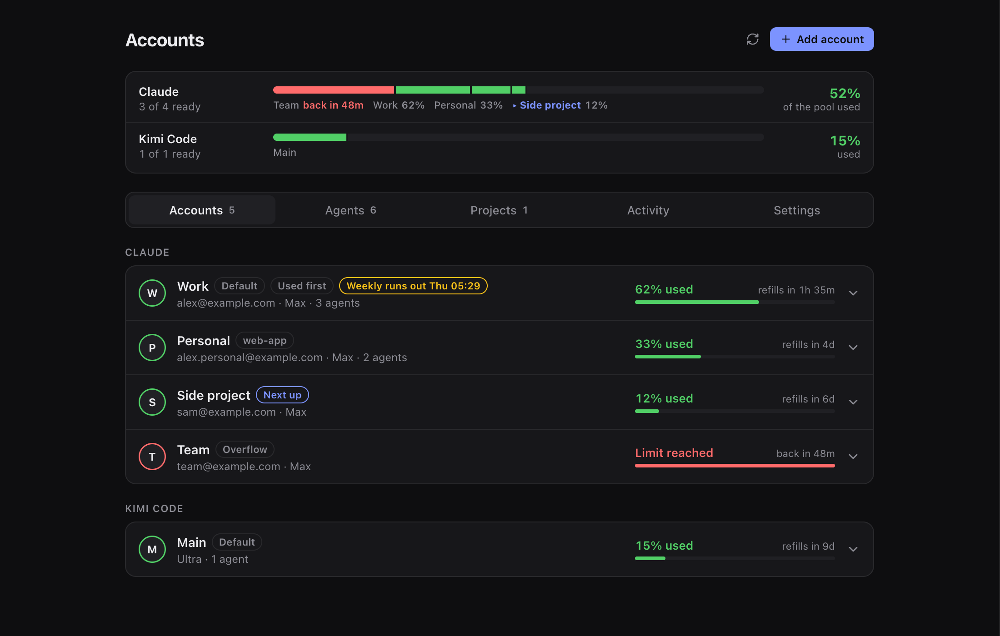

# Paseo Accounts

Use several Claude, ChatGPT (Codex), GitHub Copilot, Kimi Code, OpenCode Go, Pi and Oh My Pi subscriptions side by side in [Paseo](https://paseo.sh), without logging in and out of the CLI.



- **Add accounts in the app.** Click **Add account** under Claude or ChatGPT and sign in on any device, including your phone. You don't need a terminal, environment variables or config files.
- **Your existing CLI logins show up automatically.** Nothing changes until you add a second account.
- **Pick an account per agent.** An account button in the message box shows which account each Claude or Codex agent uses. Tap it to switch.
- **Automatic failover.** When an account hits its 5-hour or weekly limit, the agent moves to the account with the most room left and carries on. New agents skip exhausted accounts.
- **Live usage.** Each account shows its own 5-hour and weekly usage and when they reset. Accounts in use refresh about every minute and after each turn, and a limit shows up the moment it hits.
- **Banked resets.** If a provider has banked limit resets on an account, you can use one from the account card or the agent's account button.
- **Signed-out accounts stand out.** On Paseo 0.12 and later, the sidebar's **Accounts** item shows how many accounts need signing in again.
- **Set an account aside.** Disable an account for a while and its agents move to your other accounts, then come back when you enable it again.
- **Several hosts.** Each Paseo host keeps its own accounts, and the Accounts screen says which host you're looking at.
- **Fork to another provider (optional).** When every account of a provider is out, a stopped chat can carry on in a new agent on the next provider with a free account (ChatGPT, then Kimi Code, then OpenCode, Copilot, Pi, Oh My Pi), then any other provider Paseo has available on the host.
- **Copilot, Kimi Code, OpenCode Go, Pi and Oh My Pi.** Add accounts for any provider installed on the host from **Add account** at the top. A provider only gets a section (and a line in the summary) once it runs agents or has an account you added. Kimi accounts sign in with `kimi login`, show 5-hour and monthly usage, and switch on limits like Claude.
- **Project folders.** Dedicate an account to one or more folders: agents working there use it, and no other agent moves onto it.
- **Everything else stays the same.** Every account shares your settings, skills, plugins, MCP servers, `CLAUDE.md`/`AGENTS.md` and conversation history.

## Install

Requirements:

- Paseo 0.11.0 or later, with plugins enabled (**Settings → Plugins → Enable plugins**).
- The `claude` and/or `codex` CLI installed where the daemon runs, the same ones Paseo already uses.

Install it from the Paseo plugin directory (or **Paseo Cafe**):

```bash
paseo plugin add jgreys/accounts
```

To run it from a checkout instead:

```bash
git clone https://github.com/jgreys/paseo-accounts.git ~/projects/paseo-accounts
paseo plugin install ~/projects/paseo-accounts
```

After pulling or editing a checkout, apply changes with `paseo plugin reload paseo-accounts`.

Then open **Accounts** in the sidebar.

## Use it

1. Open **Accounts** in the sidebar. Your current Claude Code and Codex logins are already listed.
2. Click **Add account** under Claude or ChatGPT (Codex), then **Open sign-in page**, and sign in with the other account.
   - In a browser on the host's own computer, the page finishes by itself.
   - Anywhere else, choose **Use a code instead**. For Claude, paste the code shown after sign-in. For ChatGPT, type the code shown in Paseo on the page. Phones, and hosts without a desktop (servers, containers, daemons started over SSH), start with the code.
3. Choose which account agents use:
   - **Make default**: new agents, and agents that follow the default, use it. Open Claude agents switch right away, busy ones after their turn.
     - To leave open agents where they are, turn off **Move open agents when the default changes** (Accounts → Settings, or **Settings → Plugins → paseo-accounts**). Each open agent that follows the default then stays pinned to the account it's using, even after it reopens, unless that account is signed out, disabled or at its limit. New agents, and agents that aren't open at the time, use the new default.
     - A kept agent still switches when its account hits a limit. To move it to the new default, choose **Follow default** from its account button, or type `/account default`.
   - **The account button in an agent's message box**: moves that one agent.
   - **`/account work`** in the message box, or `/account default` to follow the default again.
   - **⌘K → "Make … the default"**.
   - **Disable for now** (the pause button on a card): the account stays signed in but paseo-accounts stops using it. Its agents move to your other accounts right away (busy ones after their turn) and come back when you press **Enable**. ChatGPT conversations already on it stay, since they can't change accounts. You can't disable the last usable account of a provider.
4. Leave **Automatic switching** on (in Accounts, or **Settings → Plugins → paseo-accounts → Account preferences**) and limits take care of themselves:
   - Only the CLIs' own limit notices trigger a switch. That covers Claude Code's "You've hit your session limit · resets 3pm" and Codex's "You’ve hit your usage limit…".
   - A short note in the agent's timeline says what happened.
   - As a safety stop, one agent changes accounts at most 4 times in 10 minutes. If it hits that, its timeline says so; pick an account from its account button to carry on.
   - An exhausted account is skipped until it resets. If you know it has room again sooner, for example after upgrading or buying credits, press **Mark as available again** (the check mark) on its card.

### Project folders

Press the folder button on an account card and list folders, one per line (`~/code/web-app`). Then:

- Agents whose working folder is in one of them (or below it) use that account. The deepest matching folder wins.
- No other agent is balanced or failed over onto it. It stays reserved for its folders.
- A choice you make for one agent (account button, `/account`) still wins over the folder.
- If the folder's account hits its limit, its agents fail over to your other accounts and come back once it has room.
- A folder belongs to one account per provider: giving it to another account takes it from the first.

### Kimi Code

Paseo runs Kimi Code CLI as the `kimi` provider. Your current `kimi` login shows up as its CLI login.

- **Add account** runs `kimi login` for a new account: open the link (on any device) and confirm the code.
- Each account gets its own `KIMI_CODE_HOME` with its own sign-in and `config.toml` (copied from yours once). Sessions, history and workspace trust are shared, so a chat moves between accounts in place.
- Usage comes from Kimi's own usage endpoint (5-hour, weekly and monthly windows). It's read while the account's token is fresh, which is whenever it's been used recently.
- A quota or rate-limit error from Kimi (`exceeded your current quota`, `Provider rate limit`, …) switches the agent like a Claude limit does.

### GitHub Copilot

- **Add account** runs `copilot login --device-code`: open GitHub's page on any device and enter the code.
- Each account gets its own `COPILOT_HOME`. Session history (`session-state`), settings, MCP config and skills are shared; the sign-in (`config.json`) is per account.
- Copilot keeps the token itself in the macOS keychain, under the GitHub user. Removing an account here leaves that keychain entry alone.
- Usage isn't shown yet (reading it needs that keychain token). Running out of AI credits or premium requests, or hitting a rate limit, switches the agent.

### Pi

- **Add account** signs the new account in to the same subscription your Pi login uses (Claude, ChatGPT or Copilot; Claude when it has none), using Pi's own sign-in code. Open the link on the host's computer and it finishes by itself, or paste the final redirect URL from any device.
- Each account gets its own `PI_CODING_AGENT_DIR`. Only `auth.json` is per account; settings, models, extensions and sessions are shared.
- Pi doesn't report subscription usage. Upstream limit messages (Claude's, ChatGPT's, rate limits) switch the agent.

### Oh My Pi

Oh My Pi keeps several accounts per provider itself and switches between them when one hits a limit. So it shows as a single card:

- The card lists every account in Oh My Pi's pool with its limits (from `omp usage --json`).
- **Add account** runs `omp login` for the provider the pool already uses (Claude when it's empty), adding one more account to Oh My Pi's own pool. Providers that take a pasted code work from any device; Claude and ChatGPT finish in a browser on the host.
- paseo-accounts doesn't route or switch Oh My Pi agents; Oh My Pi does. Remove accounts with `omp` itself.

### OpenCode Go

- **Add account** opens opencode.ai/auth: create a key there and paste it, the same as `opencode auth login` does for Go.
- The key is kept in the account's own folder (mode 600). Sessions get it through `OPENCODE_AUTH_CONTENT`, layered over your other OpenCode sign-ins, so your chat history and other providers stay as they are. Paseo runs a separate OpenCode server for agents on an added account.
- OpenCode Go doesn't publish usage, so the cards show none. Limit errors still trigger a switch.

### Before the limit, restart check and alerts

- **Switch early** (Settings → Before the limit, a number from 50 to 99, default 92% used; 100 turns it off): when an agent's turn ends on an account that full, it moves to the account with the most room before its next turn, so it doesn't stop halfway through a task. It only moves to an account that's below the line itself, never onto another project's dedicated account, and leaves agents you put on an account yourself.
- **Restart check:** a few seconds after any switch, the agent is checked. If it's stopped with an error, it's reloaded once more; if that doesn't help, you get an alert.
- **Alerts** (Settings → Alerts): an ntfy topic URL or any webhook gets a short message when every account of a provider is out, an account is signed out, or an agent didn't come back after a switch. The same alert repeats at most every 30 minutes. **Send a test alert** checks the URL first.

### Priority, pacing, forecast and activity

- **Priority** (open an account → Priority): **Use first**, **Normal**, or **Only when others are out**. Automatic picks (spreading new agents, switching at a limit or early) try first-priority accounts before normal ones, and overflow accounts only when the rest are out. An account above the early-switch level always ranks last, whatever its priority. **Make default** still decides where new agents start unless **Spread new agents** is on.
- **Pacing** (Settings → Before the limit, on by default): among accounts of the same priority, prefer the one whose weekly or monthly allowance resets soonest, so none of it is left unused.
- **History and forecast:** usage readings are kept for 8 days (`usage-history.json`). An opened account shows the last 7 days as small bars and, from the recent pace, when its weekly (or monthly) limit runs out, or that it lasts until it resets. A row shows **Runs out Fri 13:10** when that's before the reset.
- **Activity tab:** every switch across agents (early switches, limit switches, "stayed put" when everything was out), newest first, with the agent, from → to, and why. Tap an agent to open it. Kept in `switch-log.json` (last 300).

### Claude vs. ChatGPT when switching mid-conversation

- **Claude:** a conversation moves to another account in place. The agent reopens on the new account with its full history and continues.
- **ChatGPT (Codex):** Codex encrypts its reasoning per ChatGPT account, so another account can't read an existing thread. The thread stays on its account. When it hits a limit, or you pick another account for it, paseo-accounts starts a **continuation agent** on the other account. It goes in the same workspace and gets a transcript of the conversation so far, so the work keeps going. New Codex agents simply start on the chosen account.

### Banked resets

Some plans come with banked limit resets: ChatGPT's reset credits, and Claude Code's limit resets. When an account has any, its card shows how many are banked and when they expire, with a **Use reset** button. When an agent is stopped by a limit, its account button offers the reset too, and the agent carries on afterwards.

- A reset can't be undone, so paseo-accounts always asks first and says what it refills.
- **ChatGPT** uses Codex's own reset-credit API, the same one as `/usage` → reset in the Codex CLI. It never spends a credit while nothing is used up.
- **Claude** uses Claude Code's limit-reset endpoint. Anthropic decides which accounts get resets; so far it reports the tested accounts as not eligible, so the button may not appear for Claude. It shows up by itself once an account has a reset.
- **Use banked resets when every account is out** (off by default) spends one automatically, but only when every account of that provider is at its limit and the provider confirms the limit at that moment.

### When every account of a provider is out

paseo-accounts tries these in order, and a timeline note says which one happened:

1. **Use a banked reset**, if you turned on **Use banked resets when every account is out**.
2. **Fork the chat to another provider**, if you turned on **When every account is out, fork the chat to another provider** (off by default). A stopped chat continues on the next provider with a free account, in the order Claude, ChatGPT, Kimi Code, OpenCode, Copilot, Pi, Oh My Pi (skipping the chat's own provider), then any other provider Paseo lists as available — custom providers included, with no account binding:
   - The new agent opens in the same workspace with the conversation so far and goes straight back to work. It uses that provider's default model and its account with the most room left.
   - Where the provider has permission modes, the fork gets the mode closest to the original's without allowing more. A provider with nothing as careful as the original is skipped, and one with no modes at all (like Pi) runs with its own defaults. paseo-accounts never gives a fork more freedom than you gave the original.
   - The original agent stays as it was, and prompting it again while its provider is still out points to the same fork rather than starting another.
   - You can also pick the target yourself: a stopped agent's account button offers "Continue on …" for every provider with a free account.
   - With the option off, a stopped agent's account button offers **Continue on ChatGPT (new agent)…** (or Claude) instead, with a confirmation.
3. **Stop and say so**, with the time the account frees up.

## Several hosts

Paseo installs plugins per host (daemon), so install paseo-accounts on each host whose agents should use it. When more than one host has it, Paseo shows a single **Accounts** item with a host picker at the top.

- **Each host has its own accounts, default and preferences**, because the sign-ins live on the machine where the agents run. The Accounts screen and the sign-in dialog name the host they belong to.
- **An agent's account button always belongs to the agent's host**, and its **Manage accounts…** opens that host.
- **Sign the same account in on each host.** paseo-accounts never copies sign-ins between hosts. Both providers rotate sign-in tokens, so two machines sharing one token sign each other out. Separate sign-ins of the same account work fine. Limits are per account, so every host sees the combined usage and switches when it runs out.
- **Remote hosts:** phones, and hosts without a desktop, get the code sign-in automatically. For a remote computer that does have a desktop, choose **Use a code instead** unless you're sitting at it.
- **Banked resets refill the account everywhere.** Automatic use re-checks the limit with the provider first, so two hosts can't spend two resets on the same limit.

## How it works

Each added account gets its own credential home under `$PASEO_HOME/paseo-accounts/homes/`:

- Claude uses it as `CLAUDE_CONFIG_DIR`; Codex uses it as `CODEX_HOME`.
- The CLIs keep each home's login separate: Claude in its own keychain entry (`.credentials.json` on Linux), Codex in its own `auth.json`.
- Everything that isn't account-specific is a symlink back to `~/.claude` or `~/.codex`. For Claude that includes `settings.json`, `skills/`, `plugins/` and `projects/`; for Codex, `config.toml`, `sessions/` and more. Codex also shares its thread database through `CODEX_SQLITE_HOME`.
- Claude's `.claude.json` holds the account identity, so each account keeps its own copy. It's seeded from yours, and your MCP servers stay in sync.

A `before("agent.session_open")` hook sets those variables for every session Paseo opens: create, resume, refresh and import. To move a live agent, paseo-accounts reopens its session with `paseo agent reload`. It never interrupts a running turn; a busy agent moves when its turn ends.

Sign-in runs the official CLIs:

- Claude: `claude auth login`.
- Codex: `codex app-server`'s account API.

paseo-accounts never implements OAuth itself and never copies credentials between accounts.

## Privacy and security

- Credentials stay in the CLIs' own stores. The registry (`$PASEO_HOME/paseo-accounts/state.json`) holds only account names, emails, plans and which agent uses which account.
- To show Claude usage, paseo-accounts reads each account's current access token and calls Anthropic's usage endpoint, the same way Paseo's built-in usage display and `/usage` do. It never logs or stores tokens and never refreshes them itself. When you refresh usage (the ↻ button beside the title) or use a reset and a token has expired, it runs `claude -p /usage` so Claude Code renews its own sign-in. Codex usage comes from `codex app-server`.
- Using a banked reset calls the provider's own reset endpoint with that account's sign-in, and only after you confirm (or turn on automatic use).
- Removing an account moves its agents to the default account, then signs it out (`claude auth logout` / `codex` logout) and deletes its home. This happens once no agent is mid-turn on it. Abandoned sign-ins are cleaned up the same way.
- An account that still has ChatGPT conversations on it can't be removed until you archive them or continue them elsewhere, because they can't move.
- **Sign out** (Claude and ChatGPT) signs an account out but keeps it listed with its settings and project folders; its agents move to your other accounts, and **Sign in** brings the same or another account back. For your CLI login this signs the CLI out on that machine, for the terminal too (`claude auth logout` / Codex logout). Your CLI login can't be removed, only signed out; other providers' CLI logins are signed out with their own CLI.

## Limitations

- **MCP servers that use OAuth** (Linear, Notion, …) store their tokens per Claude account, so sign in to them once on each account.
- **Shared settings apply to every account.** If `~/.claude/settings.json` sets an `apiKeyHelper` or API-key `env`, every account uses that key instead of its subscription.
- **Usage for an idle Claude account** shows the last reading until the account is used again or you refresh usage. Anthropic rate-limits its usage endpoint (Claude Code and Paseo read it too), so a reading can be a few minutes old; the card then says when it was taken. Readings are saved in `$PASEO_HOME/paseo-accounts/usage.json`, so they survive restarts.
- **Password-protected daemons:** `paseo agent reload` can't authenticate. Agents then switch the next time their session starts, not immediately, and their timeline note says so.
- **Imported Codex threads** (`paseo agent import`) are assigned to your CLI login, since that's where standalone Codex sessions come from.
- **ChatGPT device-code sign-in** has to be enabled in ChatGPT → Settings → Security. The browser option works from a browser on the host's own computer.
- Tested on macOS with Claude Code 2.1.280, Codex 0.156.1 and Paseo 0.9.1. Linux should work. Windows is untested.

## Development

```bash
git clone https://github.com/jgreys/paseo-accounts.git
cd paseo-accounts
npm install
paseo plugin install "$(pwd)"   # run the working copy

npm run typecheck      # client and server bundles, separately
npm test               # routing, failover, limit detection, usage, resets, forks
npm run audit:mobile   # no DOM/HTML in client code
paseo plugin reload paseo-accounts
paseo plugin logs paseo-accounts
```

Code layout:

- `client/`: React Native UI (Accounts surface, sign-in modal, composer pill, commands, timeline note).
- `server/`: routing, account homes, Claude and Codex adapters, failover.
- `shared/`: RPC contracts and the view model.

Report problems at [github.com/jgreys/paseo-accounts/issues](https://github.com/jgreys/paseo-accounts/issues).

## Uninstall

Remove added accounts from **Accounts** first, so they're signed out. Then run:

```bash
paseo plugin remove paseo-accounts
rm -rf ~/.paseo/paseo-accounts
```
